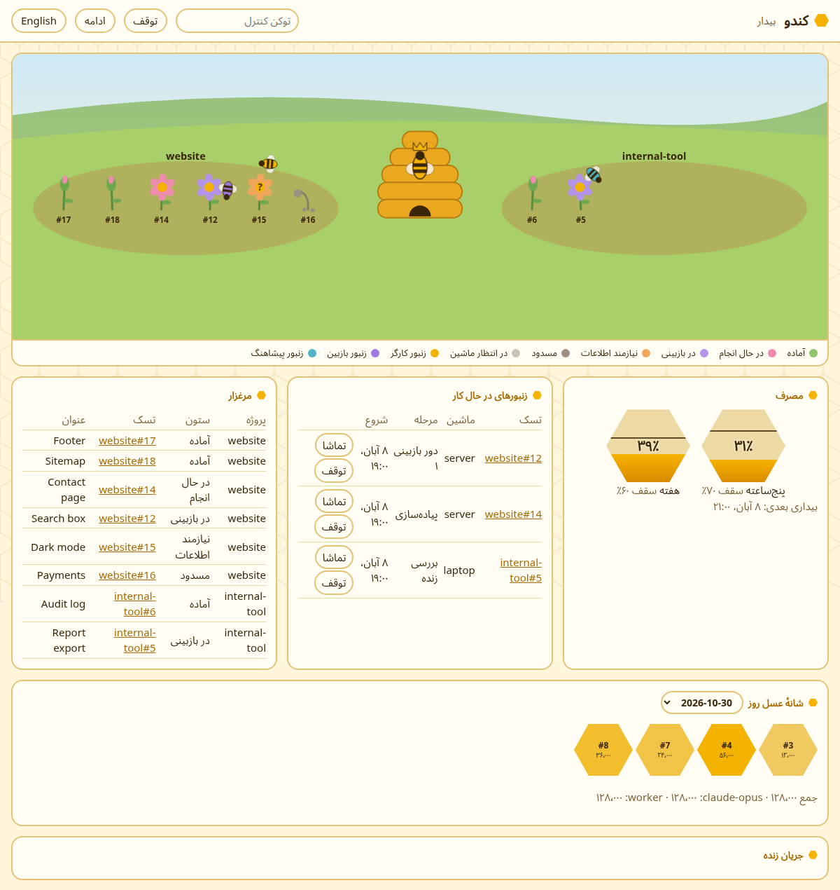

<div dir="rtl">

# کندو — `Kandu`

**یک کارخانه‌ی نرم‌افزار خودکار.** شما تسک می‌نویسید. یک لوپ از ایجنت‌های `Claude`، زیر نظر یک ناظر، تسک‌ها را برمی‌دارد، پیاده‌سازی می‌کند، تست می‌کند، ریویو می‌کند، مرج می‌کند، دیپلوی می‌کند و نتیجه را روی نرم‌افزار زنده چک می‌کند. شما ناظرِ ناظر هستید.

[English](README.md)

> **وضعیت: اوایل توسعه.** لوپ اصلی ساخته و با جایگزین‌های آزمایشی تست شده، ولی هنوز روی پروژه‌ی واقعی اجرا نشده است. مشخصات کامل در [DESIGN.md](DESIGN.md) و نقشه‌ی راه در [TASKS.md](TASKS.md) است.

کندو یعنی خانه‌ی زنبورها: کلی کارگر که هر کدام کار خودشان را می‌کنند، یک نظم بالای سرشان، و تولیدی که بی‌وقفه ادامه دارد.

## چرا

کار با ایجنت برنامه‌نویسی هنوز یعنی نشستن کنارش: تأیید تک‌تک قدم‌ها، تماشای کدنویسی‌اش، و چک کردن اینکه واقعاً کار را تمام کرده یا نه. کندو آدم را یک سطح بالاتر می‌برد. شما فقط:

1. تسک تعریف می‌کنید، با گفتگو، نه با فرم؛
2. روی داشبورد می‌بینید چه اتفاقی می‌افتد؛
3. نتیجه را روی نرم‌افزار زنده‌تان می‌بینید؛
4. هر جا ناظر اشتباه کرد، اصلاحش می‌کنید.

## چطور کار می‌کند

<div dir="ltr">

```
 you ──(conversation)──► GitHub issue on a board (Backlog)
                              │
                              ▼
 supervisor (wakes every hour, works while usage allows)
   ├─ worker 1 (own git worktree) ──► PR ──► reviewer (fresh context)
   ├─ worker 2 (own git worktree) ──► PR ──► reviewer (fresh context)
   └─ ...
                              │
                              ▼
   final check ─► merge ─► deploy ─► check in the live software ─► Done
                              │
                              ▼
          dashboard (everything, live) + notifications (important only)
```

</div>

1. **تسک‌ها `issue`های `GitHub` هستند** روی یک بورد `GitHub Project`، یک بورد برای هر مجموعه از پروژه‌ها. هر `issue` قالب ثابت دارد: هدف، رفتار فعلی، معیار قبول شدن، روش تست، خارج از محدوده، و وابستگی‌ها. فقط `issue`هایی که لیبل `agent` دارند و در ستون `Ready` هستند وارد لوپ می‌شوند.
2. **ناظر** یک لوپ کدی روی یک ماشین همیشه‌روشن است، نه یک سشن `LLM`؛ بنابراین هر کاری که قضاوت نمی‌خواهد هیچ توکنی مصرف نمی‌کند. کد پروژه را نمی‌نویسد. تسک انتخاب می‌کند، به کارگرها می‌دهد و قانون‌ها را اجرا می‌کند. هیچ‌وقت کار خودش را قضاوت نمی‌کند.
3. **ملکه** یک `LLM` بالای زنبورهای همهٔ پروژه‌هاست. تسک‌های تازه در `Backlog` می‌مانند و ملکه با سرعتی که هر پروژه می‌کشد آن‌ها را آزاد می‌کند، بر اساس اولویت، اندازه و ددلاینی که موقع تعریف تسک گذاشته شده. وقتی کاری متوقف شود، می‌خواند چه شده و تسک را با یک یادداشت برمی‌گرداند یا از شما سؤال می‌پرسد. کد هر تصمیمش را چک می‌کند: نمی‌تواند مرج کند و نمی‌تواند از دکمه‌ی توقف یا سقف مصرف رد شود. چرخه‌ی آرام توکنی برای او خرج نمی‌کند.
4. **کارگرها** پروسه‌های جدای `claude` هستند و هر کدام `git worktree` خودش را دارد. تسک‌های مستقل موازی و تسک‌های وابسته به ترتیب اجرا می‌شوند.
5. **یک ریویوکننده‌ی تازه** هر `PR` را با `issue` می‌سنجد و دنبال چیزهایی می‌گردد که واقعاً خراب می‌کنند: باگ `production`، حفره‌ی امنیتی، `crash` و منطق جدید بدون تست. هر `blocker` قبل از گزارش راستی‌آزمایی می‌شود. کارگر همه‌ی یافته‌ها را حداکثر در دو دور فیکس می‌کند و اگر بعد از آن `blocker` باز مانده باشد، تسک `Blocked` می‌شود.
6. **مرج و دیپلوی:** وقتی همه‌ی شرط‌های مرج روی همان کامیتی که ریویو شده برقرار باشند، ناظر مرج می‌کند، اگر مرج خودکار برای آن پروژه روشن باشد، و دیپلوی می‌کند. دیپلوی برای هر پروژه یا مستقیم است یا روی `preview`. تغییری که برگرداندنش سخت است همیشه منتظر شما می‌ماند. مرج خودکار خاموش شروع می‌شود، تا وقتی معلوم شود تصمیم‌های کندو با تصمیم‌های شما یکی است.
7. **«انجام شد» یعنی روی نرم‌افزار زنده دیده شود.** بعد از دیپلوی، ناظر نسخه‌ی زنده را باز می‌کند و چک می‌کند چیزی که `issue` خواسته واقعاً آنجاست. سبز بودن تست‌ها به‌تنهایی کافی نیست.
8. **حدس نمی‌زند:** تسک مبهم به ستون `Needs info` می‌رود و از شما سؤال پرسیده می‌شود.
9. **حافظه‌ی پنهان ندارد:** تمام وضعیت روی بورد و در کامنت‌های `issue` است. اگر یک دور وسط کار قطع شود، دور بعد از همان‌جا ادامه می‌دهد.

## ریتم کار

ریتم کندو را مصرف تعیین می‌کند، نه تعداد ثابت تسک:

- یک تایمر هر یک ساعت ناظر را بیدار می‌کند. این فاصله قابل تنظیم است.
- اگر چیزی برای تصمیم یا شروع نباشد یا مصرف از سقف گذشته باشد، بی‌هزینه دوباره می‌خوابد.
- وگرنه کار می‌کند تا یکی از این‌ها پیش بیاید: تسک‌ها تمام شوند، حدود ۵۰ دقیقه بگذرد، یا مصرف به سقف برسد.
- دو سقف دارد: پنجره‌ی مصرف پنج‌ساعته و مصرف هفتگی، هر دو به درصد. اگر اشتراکتان را با سشن‌های خودتان شریک هستید، حاشیه بگذارید، مثلاً ۷۰٪ و ۶۰٪.

## پروژه‌ها کجا اجرا می‌شوند

برای هر پروژه **خود شما** تعیین می‌کنید کندو کجا اجازه‌ی اجرا دارد. کندو هیچ‌وقت این را حدس نمی‌زند:

- `clone`: کندو ریپو را در پوشه‌ی کاری خودش روی ماشین ناظر `clone` می‌کند و همان‌جا کار می‌کند.
- `in-place`: کندو باید روی یک ماشین مشخص کار کند، مثلاً لپ‌تاپ شما، آن هم در یک `git worktree` جدا، نه در نسخه‌ی کاری خودتان.

ماشین‌هایی که همیشه روشن نیستند اول هر دور چک می‌شوند. اگر خاموش باشند، تسک‌هایشان منتظر می‌مانند. کافی است روشنشان بگذارید تا کندو دور بعد سراغشان برود.

## داشبورد



کندو داشبورد تعاملی خودش را دارد:

- وضعیت ناظر، زمان بیدار شدن بعدی، دلیل تمام شدن آخرین دور، و نوارهای مصرف با خط سقف
- کارگرهای فعال: تسک، پروژه، ماشین، مرحله و زمان سپری‌شده
- جریان زنده‌ی کار هر کارگر: فایل‌هایی که می‌خواند، دستورها و تغییرات؛ به‌اضافه‌ی نظرهای ریویوکننده و تصمیم‌های ناظر
- صف هر پروژه: `Backlog`، `Ready`، منتظر ماشین، `Needs info`، `Blocked`
- کارهای تمام‌شده، با لینک `PR`، لینک نسخه‌ی زنده و اسکرین‌شات چک نهایی
- کنترل‌ها: توقف و ادامه‌ی ناظر، توقف یک کارگر

داشبورد یک صفحه است و چیزی از بیرون بار نمی‌کند، پس برنامه‌ی دیگری می‌تواند آن را از طریق سرور خودش در یک قاب نشان دهد.

داشبورد روی `127.0.0.1:8790` در ماشین ناظر گوش می‌دهد؛ این پورت در `local/kandu.yaml` با `dashboard.port` تنظیم می‌شود. برای اجرا و بالا آمدن دوباره بعد از ری‌استارت:

```
.venv/bin/python -m kandu.timer --dashboard
```

این دستور ناظر را اجرا نمی‌کند. از ماشین دیگر یک تونل `SSH` بزنید و `http://127.0.0.1:8790` را باز کنید:

```
ssh -N -L 127.0.0.1:8790:127.0.0.1:8790 server
```

## دیدبان — کنترل از کامپیوتر خودتان

ناظر روی یک ماشین همیشه‌روشن اجرا می‌شود که معمولاً همان ماشینی نیست که پشتش نشسته‌اید. **دیدبان** راه حرف زدن با کندو از کامپیوتر خودتان است: یک دستور، یک سشن `Claude Code` را در نقش کنترل باز می‌کند. از همان‌جا تسک تعریف می‌کنید، وضعیت را می‌بینید و فرمان توقف و ادامه می‌دهید. دیدبان یک نقش است، نه یک سرویس، و کد نمی‌نویسد. جزئیات در [DESIGN.md](DESIGN.md) بخش ۱۳.

روی ماشینی که پشتش نشسته‌اید، در یک کلون از کندو که `.venv` دارد:

<div dir="ltr">

```
mkdir -p local
cp config.example/didban.example.yaml local/didban.yaml   # then edit it
ln -s "$PWD/bin/didban" ~/.local/bin/didban
```

</div>

سشن با اسم `Kandu` و با `Remote Control` روشن باز می‌شود، پس تا وقتی ماشین روشن است، می‌توانید از اپ موبایل `Claude` یا `claude.ai/code` ادامه‌اش بدهید.

می‌توانید در تنظیمات دسکتاپ یک میان‌بر کیبورد هم برایش بگذارید. در `GNOME`: مسیر `Settings → Keyboard → Custom Shortcuts`، با دستور `gnome-terminal -- /home/you/.local/bin/didban`.

## پیام‌ها

فقط چیزهای مهم: ناظر متوقف شد، چیزی خراب شد، یک تسک تصمیم شما را لازم دارد، یا مصرف به سقف رسید. بقیه‌ی چیزها روی داشبورد می‌مانند. `Telegram` اولین گزینه است و می‌شود گزینه‌های دیگر هم اضافه کرد.

## روش پیشنهادی: کندو را از نسخه‌ی خصوصی خودتان اجرا کنید

این ریپو قالب عمومی کندو است. بهترین راه استفاده این است که یک ریپوی خصوصی برای خودتان داشته باشید و همین ریپو را `upstream` آن کنید. این‌طوری تسک‌ها، `issue`ها و `PR`های کندوی شما خصوصی می‌مانند و `push` اشتباهی هم به یک ریپوی خصوصی می‌رود. `fork` یک ریپوی عمومی در `GitHub` نمی‌تواند خصوصی باشد، پس این یک ریپوی جدید است، نه `fork`.

<div dir="ltr">

```
git clone https://github.com/25mordad/kandu.git kandu
cd kandu
git remote rename origin upstream
git remote set-url --push upstream DISABLED
gh repo create your-login/kandu-private --private --source=. --remote=origin --push
git config core.hooksPath .githooks
python3 -m venv .venv
.venv/bin/pip install -r requirements.txt
```

</div>

برای آپدیت: `git fetch upstream && git merge upstream/main` و بعد `git push origin main`.

## راه‌اندازی — با گفتگو

فرم ندارد. کندو را با حرف زدن با خودش در `Claude Code` تنظیم می‌کنید. اول خودش سیستمتان را می‌گردد، فقط چیزهایی را می‌پرسد که نمی‌تواند بفهمد، و بعد از شما تأیید می‌گیرد.

- `/kandu-setup` یک بار اجرا می‌شود: ناظر کجا اجرا شود، چه ماشین‌هایی دارید و چطور به آن‌ها وصل می‌شوید، دسترسی به `Claude` و سقف مصرف، حساب و سازمان‌های `GitHub`، پیام‌ها و زبانشان، و تنظیمات پیش‌فرض.
- `/kandu-add` برای هر پروژه: ریپوها، محل پروژه، اجازه‌ی اجرا یعنی `clone` یا `in-place`، بورد، روش تست و دیپلوی، آدرس نسخه‌ی زنده، محل `secret`ها، بخش‌های ممنوع، قوانین ریپو، نوع مرج و اولویت.
- `/kandu-task`: تعریف تسک؛ تسک به `issue` روی بورد درست تبدیل می‌شود.
- `/kandu-config`: تغییر هر چیزی در آینده، مثلاً «این پروژه را یک هفته متوقف کن».
- `/kandu-doctor`: چک اینکه همه‌چیز کار می‌کند.

همه‌ی چیزهای شخصی در پوشه‌ی `local/` می‌روند که در `.gitignore` است: تنظیمات، فهرست پروژه‌ها، `secret`ها و یادداشت‌ها. آپدیت کندو، به روشی که بالا آمده یا با `git pull` در یک کلون ساده، هیچ‌وقت به `local/` دست نمی‌زند. نمونه‌های کامل در [config.example/](config.example/) هستند.

## پیش‌نیازها

- `Claude Code`، یعنی `claude`، با اشتراک یا کلید `API`
- `GitHub CLI`، یعنی `gh`، لاگین‌شده
- `git` و `python` نسخه‌ی ۳
- یک ماشین همیشه‌روشن برای ناظر: لینوکس با `systemd` برای تایمر
- دسترسی `SSH` به هر ماشین دیگری که پروژه‌ای روی آن `in-place` اجرا می‌شود

## ایمنی

- هیچ‌وقت با `--dangerously-skip-permissions` اجرا نمی‌شود؛ هر پروژه `allowlist` دستورهای خودش را دارد.
- هیچ‌وقت به پروژه‌ای که ثبت نکرده‌اید یا به نسخه‌ی کاری خودتان دست نمی‌زند.
- هیچ‌وقت محتوای `secret`ها را کپی یا ثبت نمی‌کند.
- هیچ‌وقت بدون تأیید شما ایمیل یا پیام نمی‌فرستد، پرداخت نمی‌کند و از سرویس پولی استفاده نمی‌کند.
- هیچ‌وقت خودش چیزی را `revert` نمی‌کند: اگر چیزی خراب شود، گزارش می‌دهد و شما تصمیم می‌گیرید.
- به قوانین هر ریپو احترام می‌گذارد: `CI`، بات‌های `PR` و شاخه‌های محافظت‌شده.

## انتخاب‌هایی که می‌توانید عوض کنید

**ایزوله‌سازی.** نسخه‌ی اول بدون `container` و بدون کاربر جدای سیستم‌عامل اجرا می‌شود، با یک پوشه‌ی کاری جدا و `allowlist` برای هر پروژه. `container` خودش توکن بیشتری مصرف نمی‌کند؛ هزینه‌اش راه‌اندازی و نگهداری است، چون همه‌ی ابزارها و دسترسی‌ها باید به داخلش داده شوند. اگر ایزوله‌سازی می‌خواهید، دو راه دارید: یک کاربر لینوکس جدا، که ساده است و سربار کمی دارد، یا `Docker`، که قوی‌ترین ایزوله‌سازی است ولی نگهداری بیشتری می‌خواهد. جزئیات در [DESIGN.md](DESIGN.md#9-isolation--none-in-this-version) بخش ۹.

**هویت `GitHub`.** نسخه‌ی اول با حساب `GitHub` خودتان کار می‌کند. هر کاری که کندو انجام می‌دهد علامت دارد: شاخه‌ی `kandu/...`، لیبل `kandu` و یک خط در پیام کامیت. اگر می‌خواهید کار کندو از کار خودتان جدا باشد، یک حساب بات یا `GitHub App` با توکنی محدود به ریپوهای ثبت‌شده بسازید. جزئیات در [DESIGN.md](DESIGN.md#10-github-identity--the-users-own-account) بخش ۱۰.

## مرتبط

[Jadu](https://github.com/25mordad/Jadu) یک روش کار برای سشن‌هایی است که شما همراه ایجنت کار می‌کنید. کندو لایه‌ی خودکاری است که بعد از آن‌ها کار را ادامه می‌دهد.

روش‌های خطر مرج، تقسیم تسک، متن `PR`، دیباگ، تست و نوشتن پرامپت در کندو از [mattpocock/skills](https://github.com/mattpocock/skills) با مجوز `MIT` اقتباس شده‌اند.

## لایسنس

[MIT](LICENSE)

</div>
