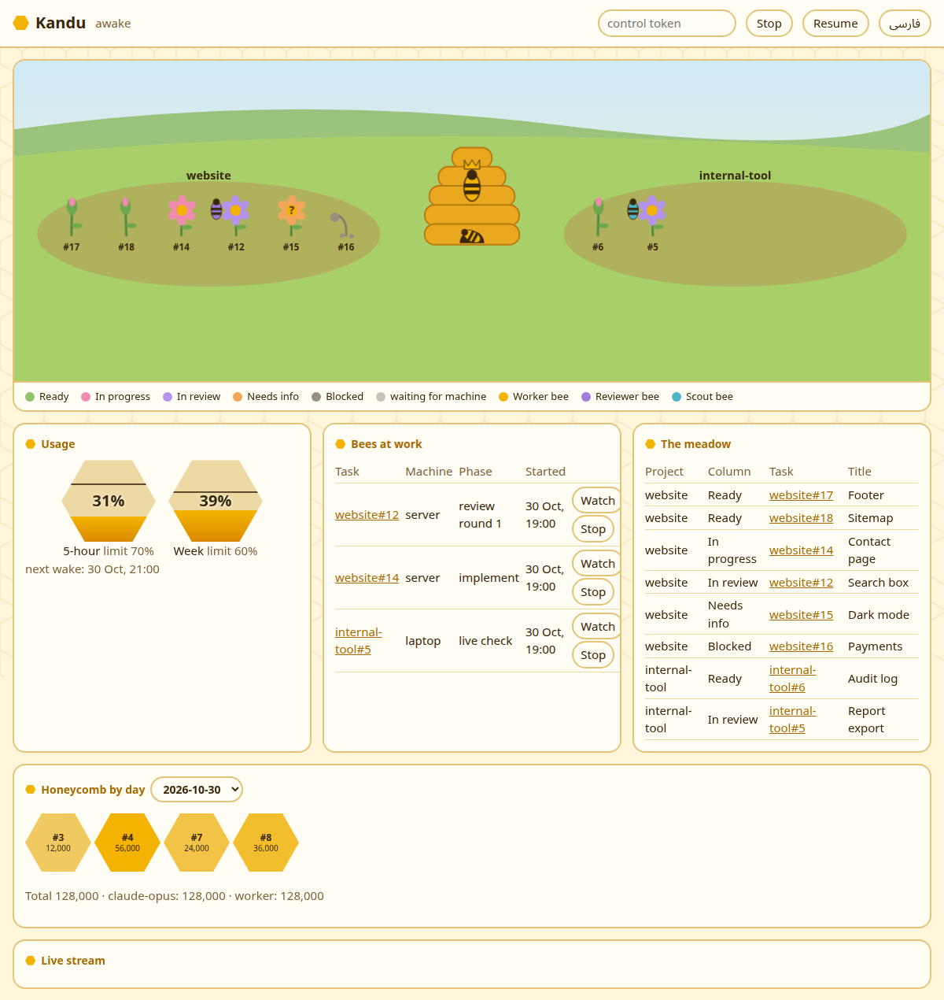

# Kandu (کندو)

**An autonomous software factory.** You write tasks. A supervised loop of Claude agents picks them up, implements them, tests them, reviews them, merges them, deploys them and checks the result in the live software. You supervise the supervisor.

[فارسی](README.fa.md)

> **Status: early development.** The main loop is built and tested with stand-ins, and has not run on a real project yet. The full specification is in [DESIGN.md](DESIGN.md), the roadmap in [TASKS.md](TASKS.md).

*Kandu* is Persian for beehive: many workers, each doing its own job, an order above them, and production that never stops.

## Why

Working with a coding agent today still means sitting next to it: approving steps, watching it code, checking whether it really finished. Kandu moves the human one level up. You only:

1. describe tasks (in a conversation, not a form),
2. watch what is happening on a dashboard,
3. see the result in your live software,
4. correct the supervisor when it gets something wrong.

## How it works

```
 you ──(conversation)──► GitHub issue on a board (Backlog)
                              │
                              ▼
 supervisor (wakes every hour, works while usage allows)
   ├─ worker 1 (own git worktree) ──► PR ──► reviewer (fresh context)
   ├─ worker 2 (own git worktree) ──► PR ──► reviewer (fresh context)
   └─ ...
                              │
                              ▼
   final check ─► merge ─► deploy ─► check in the live software ─► Done
                              │
                              ▼
          dashboard (everything, live) + notifications (important only)
```

1. **Tasks are GitHub issues** on a GitHub Project board, one board per project family. Each issue has a fixed template: goal, current behavior, acceptance criteria, how to test, out of scope, blocked by. Only issues labelled `agent` in the `Ready` column enter the loop.
2. **The supervisor** is a code loop on an always-on machine, not an LLM session, so everything that needs no judgment costs no tokens. It writes no code. It picks tasks, hands them to workers and enforces the rules. It never grades its own work.
3. **The queen** is one LLM above the workers of all projects. New tasks wait in `Backlog`, and she releases them at a pace each project can take, from the priority, size and deadline set when the task was defined. When something stops, she reads what happened, then sends the task back with a note or asks you a question. Code checks each decision: she cannot merge, and she cannot pass the stop button or the usage limits. A quiet cycle wakes her at no cost.
4. **Workers** are separate `claude` processes, each in its own `git worktree`. Independent tasks run in parallel; dependent tasks run in order.
5. **A fresh reviewer** checks every PR against the issue and hunts for what really breaks: production bugs, security holes, crashes, and new logic with no test. Each blocker is verified before it is reported. The worker fixes every finding, for at most two rounds; a blocker still open after that marks the task `Blocked`.
6. **Merge and deploy:** when every merge condition holds on the exact commit that was reviewed, the supervisor merges (if auto-merge is on for that project) and deploys, directly or to a preview, per project. A change that is hard to undo always waits for you. Auto-merge starts off, until Kandu's decisions have been shown to match yours.
7. **"Done" means seen in the live software.** After deploy the supervisor opens the live version and checks that what the issue asked for is really there. Green tests alone are not enough.
8. **No guessing:** a vague task goes to `Needs info` and you get a question.
8. **No hidden memory:** all state lives on the board and in issue comments. A cycle that is cut off resumes where it stopped.

## Rhythm

Kandu is paced by usage, not by a fixed number of tasks:

- A timer wakes the supervisor every hour (configurable).
- If there is nothing to decide or start, or usage is over a limit, it goes back to sleep immediately, at no cost.
- Otherwise it works until the tasks run out, about 50 minutes pass, or a usage limit is reached, whichever comes first.
- Two limits: the 5-hour usage window and the weekly usage, both in percent. If you share a subscription with your own sessions, keep a margin (for example 70% and 60%).

## Where projects run

For every project **you** decide where Kandu may run it. Kandu never infers this:

- `clone`: Kandu clones the repo into its own work folder on the supervisor's machine and works there.
- `in-place`: Kandu must work on a specific machine, for example your laptop, in a separate `git worktree` there, never in your own working copy.

Machines that are not always on are checked at the start of every cycle. If a machine is off, its tasks wait. Leave it on, and Kandu picks them up in the next cycle.

## Dashboard



Kandu has its own interactive dashboard:

- supervisor state, next wake time, why the last cycle stopped, usage bars with the limit lines
- active workers: task, project, machine, phase, elapsed time
- a live stream of what every worker does (files read, commands, edits), the reviewer's notes and the supervisor's decisions
- queues per project: Backlog, Ready, waiting for machine, Needs info, Blocked
- finished work, with PR link, live link and a screenshot of the final check
- controls: stop / resume the supervisor, stop a worker

The dashboard is one page with no outside requests, so another app can show it in a frame through its own server.

It listens on `127.0.0.1:8790` on the supervisor's machine (`dashboard.port` in `local/kandu.yaml`). To start it and keep it running after a restart:

```
.venv/bin/python -m kandu.timer --dashboard
```

This does not start the supervisor. From another machine, open an SSH tunnel and then `http://127.0.0.1:8790`:

```
ssh -N -L 127.0.0.1:8790:127.0.0.1:8790 server
```

## Didban — control from your own machine

The supervisor runs on an always-on machine, which is usually not the one you sit at. **Didban** (Persian for "lookout") is how you talk to Kandu from your own machine: one command opens a Claude Code session in the control role. From there you define tasks, see state and stop or resume the supervisor. Didban is a role, not a service, and it does not write code. Details in [DESIGN.md](DESIGN.md#13-didban--control-from-your-own-machine).

On the machine you sit at, in a clone of Kandu with its `.venv`:

```
mkdir -p local
cp config.example/didban.example.yaml local/didban.yaml   # then edit it
ln -s "$PWD/bin/didban" ~/.local/bin/didban
```

The session opens with the name `Kandu` and Remote Control on, so you can continue it from the Claude mobile app or claude.ai/code while the machine stays on.

You can also bind it to a keyboard shortcut in your desktop's settings. On GNOME: Settings → Keyboard → Custom Shortcuts, with the command `gnome-terminal -- /home/you/.local/bin/didban`.

## Notifications

Only the important things, for example the supervisor stopped, something broke, a task needs your decision, a usage limit was reached. Everything else stays on the dashboard. Telegram is the first adapter; the notifier is pluggable.

## Recommended: run Kandu from your own private copy

This repo is the public template. The best way to use Kandu is to keep your own private repo and use this one as `upstream`. Your tasks, issues and PRs on Kandu itself stay private, and a push by mistake goes to a private repo. (A GitHub fork of a public repo cannot be private, so this is a new repo, not a fork.)

```
git clone https://github.com/25mordad/kandu.git kandu
cd kandu
git remote rename origin upstream
git remote set-url --push upstream DISABLED
gh repo create your-login/kandu-private --private --source=. --remote=origin --push
git config core.hooksPath .githooks
python3 -m venv .venv
.venv/bin/pip install -r requirements.txt
```

To update: `git fetch upstream && git merge upstream/main`, then `git push origin main`.

## Setup — by conversation

There are no forms. You configure Kandu by talking to it in Claude Code. It first looks at your system itself and only asks what it cannot find out, then asks you to confirm.

- `/kandu-setup` (once): where the supervisor runs, which machines exist and how to reach them, Claude access and usage limits, GitHub account and owners, notifications and language, defaults.
- `/kandu-add` (per project): repos, location, permission to run (`clone` or `in-place`), board, how to test and deploy, live URL, where secrets are, forbidden areas, repo rules, merge mode, priority.
- `/kandu-task`: define a task; it becomes an issue on the right board.
- `/kandu-config`: change anything later ("pause this project for a week").
- `/kandu-doctor`: check that everything works.

Everything personal goes into `local/`, which is gitignored: your config, project registry, secrets and notes. Updating Kandu, as shown above or with `git pull` in a plain clone, never touches `local/`. Complete examples are in [config.example/](config.example/).

## Requirements

- [Claude Code](https://claude.com/claude-code) (`claude`), with a subscription or an API key
- [GitHub CLI](https://cli.github.com/) (`gh`), logged in
- `git`, `python` 3
- an always-on machine for the supervisor (Linux with `systemd` for the timer)
- SSH access to any other machine where projects run `in-place`

## Safety

- Never runs with `--dangerously-skip-permissions`; each project has its own command allowlist.
- Never touches a project you have not registered, or your own working copy.
- Never copies or logs secret values.
- Never sends email or messages, makes payments or uses paid services without your approval.
- Never reverts on its own: if something breaks, it reports it and you decide.
- Respects each repo's own rules (CI, PR bots, protected branches).

## Choices you can change

All of these live in `local/kandu.yaml`; `/kandu-config` changes them by conversation. A complete example is in [config.example/](config.example/).

**Language.** Kandu is in English unless you say otherwise. Set `language: fa` at the top level, and its messages, briefs and split proposals come in that language, and the dashboard opens in it. The page itself has English and Persian; agent-written text works in any language. Everything on GitHub stays in English: issues, PRs and commits. A split proposal is stored locally with its whole text in your language, and only the English becomes issues. Updating from an older version: move `notify.language` to the top-level `language`.

**Model per role.** `claude.models` names a model for `worker`, `reviewer`, `splitter`, `live_check` or `queen`. A role not named runs on Claude's default, so you can put cheap, mechanical roles on a smaller model and keep judgment on a stronger one.

**Isolation.** Version 1 runs without a container or a separate OS user, with a separate work folder and per-project allowlists. A container does not by itself cost more tokens; the cost is the setup and upkeep of passing every tool and credential into it. If you want isolation, you can use a separate Linux user (simple, little overhead) or Docker (strongest, more upkeep). See [DESIGN.md §9](DESIGN.md#9-isolation--none-in-this-version).

**GitHub identity.** Version 1 works with your own GitHub account. Everything Kandu does is marked: branch `kandu/...`, label `kandu`, and a line in the commit message. If you want Kandu's work separated from yours, set up a bot account or GitHub App with a token limited to your registered repos. See [DESIGN.md §10](DESIGN.md#10-github-identity--the-users-own-account).

## Related

[Jadu](https://github.com/25mordad/Jadu) is a workflow for sessions where you work together with the agent. Kandu is the autonomous layer that continues after them.

Kandu's practices for merge danger, task slicing, PR bodies, debugging, testing and prompt writing are adapted from [mattpocock/skills](https://github.com/mattpocock/skills) (MIT).

## License

[MIT](LICENSE)
